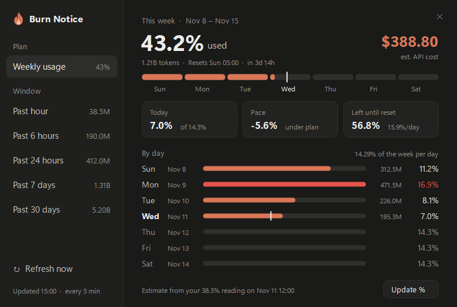
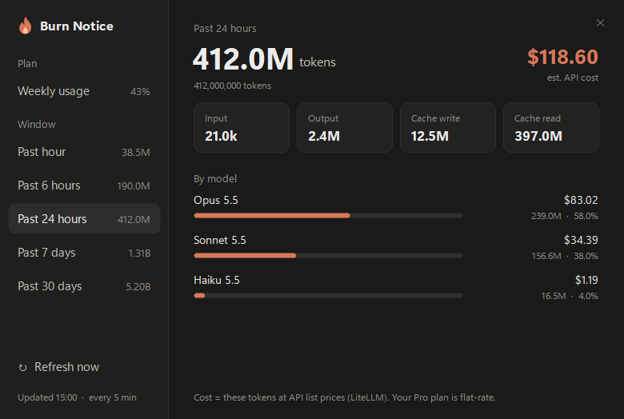

<div align="center">

# 🔥 AI Token Burn Notice

### See how many **Claude Code** tokens you burn, and pace your **weekly limit**, from the Windows tray.
*Past hour to past month, per model, with an estimated API cost, and a week split into seven daily slots.*

[**⬇ Download the latest version**](https://github.com/MatusRiedl/ai-token-burn-notice/archive/refs/heads/main.zip)
&nbsp;·&nbsp; [Get started](#-get-started) &nbsp;·&nbsp; [Known issues](#-known-issues) &nbsp;·&nbsp; [How it works](#how-it-works)



*Screenshots use synthetic demo data.*

</div>

> [!IMPORTANT]
> This is an unofficial hobby tool, tested on one PC. The weekly % is **an estimate** from your own logs, not Anthropic's number.
> It is not affiliated with or endorsed by Anthropic. Everything is computed on your PC from log files Claude Code already writes.

## ✨ Highlights

- 📅 **A weekly budget you can pace.** Your limit resets Sunday 05:00. The week is cut into 7 slots of **14.29%** (100 ÷ 7) each, so you can see at a glance whether today is over or under its share.
- 📍 **An even-pace marker** on the week bar and on today's row shows where you would be if you spread the week evenly.
- 🧮 **Today, Pace, Left until reset.** Three cards: today against its slot, how far over or under plan you are, and how many % per day are left.
- ⏱ **Past hour, 6 hours, 24 hours, 7 days, 30 days.** Total tokens and a mix of input, output, cache write and cache read.
- 🤖 **Per model.** Opus, Sonnet, Haiku and friends, each with its share and its cost.
- 💵 **Estimated API cost** at public list prices. On a Pro or Max plan you pay a flat fee, so this is "what it would have cost".
- 🔔 **A tray icon** whose tooltip shows week %, today and the last hour. Click it for the panel. Refreshes every 5 minutes.
- 🖱 **One double-click to start**, with a desktop shortcut that opens the panel (or starts the tray if it closed) and an optional Start with Windows.
- 🔒 **Local only.** The one thing it downloads is the public price list, once a day.

<div align="center">

</div>

## 🚀 Get started

Needs Windows 10 or 11, PowerShell 5.1 (built in) and [Node.js](https://nodejs.org).

1. [Download the zip](https://github.com/MatusRiedl/ai-token-burn-notice/archive/refs/heads/main.zip) and extract it somewhere that stays put, for example `Documents`. Or clone it:
   ```powershell
   git clone https://github.com/MatusRiedl/ai-token-burn-notice.git
   ```
2. In that folder run:
   ```powershell
   powershell -ExecutionPolicy Bypass -File install.ps1 -Startup
   ```
   That puts an **AI Burn Notice** shortcut on your desktop and starts the app. Leave out `-Startup` if you don't want it to start with Windows.
3. Click **Weekly usage**, then **Set weekly %**, and type the weekly limit % shown in Claude's Settings → Usage. Do this once.
4. Look at the tray. If you don't see the flame, it is behind the **^** arrow next to the clock: drag it onto the taskbar.

If the tray ever closes, double-click the desktop shortcut. To remove the shortcuts: `install.ps1 -Uninstall`.

## What you need

| | |
|---|---|
| System | Windows 10 or 11 |
| Claude | [Claude Code](https://claude.com/claude-code) (CLI, VS Code or desktop app), which writes the logs the tool reads |
| Runtime | [Node.js](https://nodejs.org), any current version |
| Shell | Windows PowerShell 5.1, already part of Windows |

No other dependencies: the panel is drawn with the .NET that ships with Windows.

## 🐞 Known issues

- **The weekly % is an estimate.** One reading from Settings → Usage tells the tool what a % of your limit costs; everything else is scaled from it. A reading taken at 40% is more accurate than one taken at 3%, so update it now and then.
- **Only Claude Code on this PC is counted.** Chat, the web app and your phone use the same limit but write no local logs, so they are missing from the day-by-day numbers.
- **Reset time is fixed to Sunday 05:00.** If yours differs, change `RESET_DAY` and `RESET_HOUR` at the top of `aggregate.js`.
- **History is as long as your logs.** Claude Code deletes session logs after 30 days by default (`cleanupPeriodDays`), so the 30-day view can't look further back.
- **Cost is a list-price estimate** from [LiteLLM's price list](https://github.com/BerriAI/litellm/blob/main/model_prices_and_context_window.json). A model missing from it is counted in tokens but not in cost, and its cost is marked with `*`.
- **Windows only.** The tray and panel use Windows Forms.
- **Tested on one PC.** Other DPI settings and multi-monitor layouts have not been tried.

**Hit a problem?** Open an [issue](https://github.com/MatusRiedl/ai-token-burn-notice/issues). `tray.log` in `%LOCALAPPDATA%\AIBurnNotice` records every start, stop and error. A start with no matching stop means the tray closed unexpectedly.

<details>
<summary><b>How it works</b></summary>

## How it works

- `aggregate.js` reads the session logs Claude Code writes to `~/.claude/projects/**/*.jsonl` and adds up the token usage of every message. Logs are append-only, so each run only reads the bytes added since the last one. Messages are de-duplicated by message id and request id.
- **Cost** is those tokens times the public per-token prices, with 5-minute and 1-hour cache writes priced separately. Prices are refreshed once a day.
- **The week** runs from Sunday 05:00 local time to the next Sunday 05:00, cut into seven day slots with local-date arithmetic, so a clock change doesn't shift the 05:00.
- **Calibration** divides the cost logged this week up to your reading by the % you typed, which gives a budget in dollars. Cost, not tokens, is used because about 97% of the tokens are cheap cache reads. The cost at calibration time is stored with the reading, since old log lines are pruned.
- `tray.ps1` is the tray icon and the panel, WinForms and GDI+ with custom drawing and Windows 11 rounded corners.
- State lives in `%LOCALAPPDATA%\AIBurnNotice`: the parse cache, the price list, your calibration, the latest numbers and the log. Set `BURN_NOTICE_DATA` to keep it somewhere else.

</details>

<details>
<summary><b>Files</b></summary>

| File | Purpose |
|---|---|
| `aggregate.js` | Log parser, rolling windows, weekly buckets, calibration |
| `tray.ps1` | Tray icon and panel |
| `start.vbs` | Starts the tray without a console window |
| `install.ps1` | Creates or removes the desktop and Start-with-Windows shortcuts |
| `flame.ps1`, `make-icon.ps1`, `assets/flame.ico` | The flame mark and the icon generator |

</details>

## Disclaimer

AI Token Burn Notice is an independent, unofficial project. It is not affiliated with, endorsed by or sponsored by Anthropic. "Claude" and "Claude Code" are trademarks of Anthropic and are used here only to say what the tool reads. It only reads local files on your own machine, and its numbers are estimates.

## License

[MIT](LICENSE)
